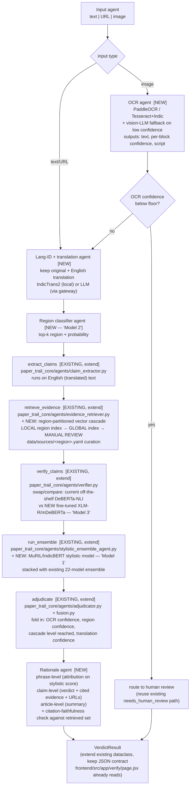

# Target architecture

How the brief's multilingual/OCR/RAG upgrade maps onto the existing
`paper_trail_core/agents/pipeline.py` LangGraph. This extends the current
5-node graph — it does not replace it. Nodes already shipped and working for
English text (`extract_claims`, `retrieve_evidence`, `verify_claims`,
`run_ensemble`, `adjudicate`, plus the `with_stage_guard`/`Degradation`
machinery) are kept; new nodes slot in front of and alongside them.

See `docs/CURRENT_STATE.md` for what's already built vs. net-new.

---

## Pipeline diagram



Everything downstream of `extract_claims` is the existing graph with new
inputs feeding it (translated English text) and new features feeding
`adjudicate` (OCR/translation/region confidence, cascade level). The stage-
guard/timeout/`Degradation` pattern (`paper_trail_core/agents/pipeline.py`,
`degradations.py`) extends directly to the four new nodes — each gets its own
`CLAIM_BACKEND`-style config flag and fallback, per the existing convention.

---

## What changes in shared state

`PipelineState` (`paper_trail_core/agents/state.py`) gains fields; existing
fields are untouched so old code paths and tests keep working:

```python
# new, all Optional / defaulted so text-only English submissions
# (today's only path) are unaffected
input_type: str                 # "text" | "url" | "image"
raw_image_ref: Optional[str]
ocr_text: Optional[str]
ocr_confidence: Optional[float]
ocr_script: Optional[str]
detected_language: Optional[str]
original_text: Optional[str]    # never discarded, per brief
translated_text: Optional[str]
translation_confidence: Optional[float]
region_top_k: Optional[list[dict]]   # [{region, probability}, ...]
retrieval_cascade_level: Optional[str]  # "local" | "global" | "manual_review"
rationale: Optional[dict]       # {phrase, claim, article}
```

`article_text` continues to mean "the English text the rest of the pipeline
runs on" — for a non-English submission that's `translated_text`, decided in
the lang-ID/translation node, so `extract_claims` through `adjudicate` don't
need to know the input was ever non-English.

---

## Decisions locked in (2026-09-25)

All open questions below are resolved. This is now the plan, not a menu.

**Compute:** Local GPU — RTX 4050 Laptop, 6 GB VRAM. Fits base-size
multilingual encoders (MuRIL-base, IndicBERT-base, XLM-R-base) fine-tuned
with fp16 + small batch/grad-accumulation. **Setup blocker found:** the
currently installed `torch` reports `cuda.is_available() == False` — needs
reinstalling against a CUDA build before any training script runs. Fix this
first, as part of environment setup, not as a training-time surprise.

| Decision | Choice |
|---|---|
| Model 1 (MuRIL/IndicBERT stylistic) | Full fine-tune (fits in 6 GB at base size) |
| Model 2 (region classifier) | Fine-tune DistilmBERT/MuRIL-base — small model, coarse label set (below), well within budget |
| Model 3 (XLM-R/mDeBERTa NLI) | Full fine-tune, compare against the current off-the-shelf `DeBERTa-v3-base-mnli-fever-anli` as baseline |
| Translation | IndicTrans2, local |
| OCR | PaddleOCR (GPU-accelerated) primary + vision-LLM (Anthropic, via gateway) fallback for low-confidence blocks |
| Region granularity | **Coarse**: National, International, North, South, East, West (6 classes total) — not full state/zone-level. Revisit granularity only if the labeled set supports it later. |
| Vector store | **FAISS**, local file-based. No server dependency; fits local-GPU/local-dev setup. |
| Source curation (`data/sources/<region>.yaml`) | Claude proposes a seed list per region (well-known national/regional outlets + fact-checkers, e.g. PIB Fact Check, BOOM, Alt News, The Hindu, etc.) for the user to review/edit — not auto-generated silently, not blocked on the user writing it from scratch. |
| First language (MVP) | **Hindi** — strongest IndicTrans2/MuRIL support, largest existing Indic fake-news dataset availability (IFND etc.). Telugu and Tamil are stretch-tier. |
| Teammate code | Does not exist in this repo or elsewhere yet. No code to avoid touching today — keep new API endpoints/schemas clean and documented so teammates can build against them later. |
| Scope tier | **MVP first** (below), stretch tier deferred explicitly, not silently dropped. |

## MVP tier (build this first)

- Image input + OCR (PaddleOCR + Indic Hindi pack, vision-LLM fallback)
- Hindi language support end-to-end (lang-ID, IndicTrans2 translation, eval)
- Region classifier: 6 coarse classes
- Retrieval cascade: LOCAL (region FAISS partition) → GLOBAL (FAISS) → MANUAL REVIEW, seeded with 2-3 regions' source YAMLs first (not all 6 at once)
- Model 1 (stylistic, Hindi+English) and Model 3 (NLI) fine-tuned on the RTX 4050; Model 2 (region) fine-tuned
- Claim-level + article-level rationale (phrase-level attribution deferred to stretch)
- Extend existing `scripts/evaluate_pipeline.py` for OCR/Hindi/region metrics rather than a from-scratch `eval_all.py`
- LLM gateway: minimal version (Anthropic primary, schema validation, retry/backoff) — full guardrail suite is stretch

## Stretch tier (explicitly deferred, not dropped)

Telugu + Tamil support, full region granularity (state-level), phrase-level
attribution (integrated gradients/SHAP), full LLM guardrail suite
(prompt-injection defense, PII redaction, rate-limiting), 100+-case golden
eval set across all languages/modalities, human-review → retraining loop,
`docs/CONCEPTS.md` viva pack, `docs/FINAL_REPORT.md`.

---

## Repo layout additions (proposed, not yet created)

```
paper_trail_core/
  agents/
    ocr_agent.py                 # NEW
    lang_translation_agent.py    # NEW
    region_classifier_agent.py   # NEW
    rationale_agent.py           # NEW
    evidence_retriever.py        # EXTEND: cascade + region partitions
    verifier.py                  # EXTEND: pluggable NLI backend (off-the-shelf vs fine-tuned)
    stylistic_ensemble_agent.py  # EXTEND: stack in Model 1
    adjudicator.py                # EXTEND: new confidence inputs
  llm/
    gateway.py                    # NEW — single call surface, routing, retry, fallback
    guardrails.py                 # NEW — prompt-injection defense, schema validation, PII redaction
    prompts/                      # NEW — versioned prompt templates
  retrieval/
    vector_store.py               # NEW
    region_index_builder.py       # NEW
data/
  sources/
    <region>.yaml                 # NEW — curated per-region trusted sources
models/
  stylistic_multilingual/         # NEW — Model 1 artifacts + MODEL_CARD.md
  region_classifier/               # NEW — Model 2 artifacts + MODEL_CARD.md
  claim_verifier/                  # NEW — Model 3 artifacts + MODEL_CARD.md
scripts/
  train_stylistic_multilingual.py  # NEW
  train_region_classifier.py       # NEW
  train_claim_verifier.py          # NEW
  eval_all.py                      # NEW — orchestrates evaluate_pipeline.py + new multilingual/OCR/rationale checks
docs/
  API.md                           # NEW
  CONCEPTS.md                      # NEW (viva doc)
  FINAL_REPORT.md                  # NEW (end of project)
```

Existing `api/`, `frontend/` (teammate's — untouched), `tests/`,
`export_models.py`, `preprocess.py`, `notebooks/` stay as-is; `api/schemas.py`
and `api/routers/articles.py` gain fields for the new endpoints
(`/verify/text`, `/verify/url`, `/verify/image`) while keeping the current
`/articles/submit` contract backward compatible for the frontend.
